<!-- 01 Em produção (comentado a pedido do Mateus; descomentar pra voltar)

-->

<!-- 03 Projetos (comentado a pedido do Mateus; descomentar pra voltar)

-->

<a href="https://felini.dev">felini.dev</a> · <a href="https://www.linkedin.com/in/mateus-felini-737a35209/">LinkedIn</a>

